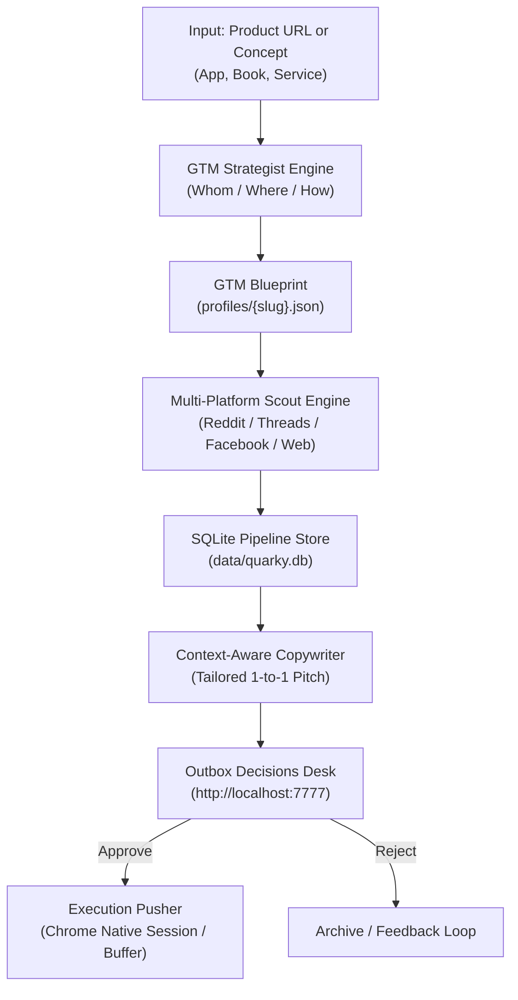
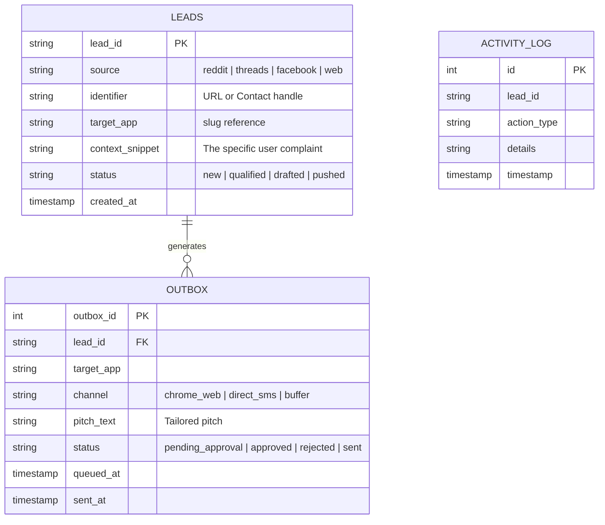

# Quarky — System Design & Architecture Specification

> **Autonomous B2C Go-To-Market (GTM) & Lead Acquisition Engine**  
> *Inspired by Harvey's autonomous loop, re-engineered for B2C apps, books, and digital products.*

---

## 1. Executive Summary & Vision

### The Problem
Traditional outbound sales tools (Apollo, Clay, ZoomInfo, Harvey) are built exclusively for **B2B email outbound**. They scrape corporate domains, find work email patterns, and send corporate cold emails. 

When you have a **B2C product** (such as an app like **TrackSub** or **FeelsRight**, or a book on **Human Nature & Power**):
* Consumers do not have corporate domain directories.
* Sending unsolicited cold emails or cold SMS to personal contacts is illegal (TCPA / GDPR) and converts at <0.5%.
* Traditional social media scheduling (posting generic Reels/Shorts) generates zero direct-response sales.

### The Solution: Quarky
**Quarky** is a **product-agnostic, high-intent problem-solution matching engine**. Given any product (an app, a book, a course, or a service), Quarky dynamically analyzes:
1. **WHOM**: Identifies customer archetypes, burning pain points, and specific trigger events.
2. **WHERE**: Maps the exact communities where those people congregate (Subreddits, Threads topics, Facebook Groups, Book discussion hubs).
3. **HOW**: Crafts platform-native, empathetic conversion copy (avoiding corporate AI fluff).
4. **EXECUTION**: Stages leads in a **Decisions Outbox Desk** and executes 1-click or autonomous outreach via native browser sessions (bypassing gatekept developer APIs).



---

## 2. Code Hosting & Environment

| Property | Value | Notes |
| :--- | :--- | :--- |
| **Remote Repository** | `https://github.com/bidya271/instagram` | Forked from `ethanplusai/harvey` |
| **Local Workspace** | `/Users/bidya/Documents/side hustle/socials` | macOS local environment |
| **Python Runtime** | Python 3.14 (`/opt/homebrew/bin/python3`) | Virtual environment at `.venv/` |
| **Database** | SQLite at `data/quarky.db` | Embedded, zero-configuration |
| **Web UI Dashboard** | `http://localhost:7777` | Native standard-library HTTP server |

---

## 3. Directory & File Structure

```
side hustle/socials/
├── quarky/                        # The Core Quarky Package
│   ├── profiles/                  # Saved Product GTM Blueprints
│   │   ├── tracksub.json          # Blueprint for TrackSub (Utility App)
│   │   ├── feelsright.json        # Blueprint for FeelsRight (Relationship App)
│   │   └── book_*.json            # Blueprint for Books (Human Nature/Power)
│   ├── web/                       # Zero-Dependency UI Dashboard
│   │   ├── index.html             # Input field, Strategy view & Outbox desk
│   │   ├── style.css              # Dark-mode sleek typography & layout
│   │   └── app.js                 # Frontend state & API controller
│   ├── strategist.py              # Analyzes any product & generates GTM blueprints
│   ├── db.py                      # SQLite ORM & state engine
│   ├── scout.py                   # High-intent conversation harvester
│   ├── writer.py                  # Platform-native 1-to-1 pitch copywriter
│   ├── pusher.py                  # Chrome AppleScript & clipboard bridge
│   ├── server.py                  # Local Web API server (port 7777)
│   └── cli.py                     # Command-line interface (`python3 -m quarky`)
│
├── harvey/                        # Legacy base engine (B2B outbound)
├── data/
│   ├── quarky.db                  # Live SQLite database for Quarky
│   └── social_growth.db           # Auxiliary social daemon database
└── QUARKY_SYSTEM_DESIGN.md        # This specification file
```

---

## 4. Database Schema (`data/quarky.db`)

The state machine is built on SQLite with three primary tables:



### DDL Schema:
```sql
CREATE TABLE IF NOT EXISTS leads (
    lead_id TEXT PRIMARY KEY,
    source TEXT,                -- 'reddit', 'threads', 'facebook', 'web'
    identifier TEXT,            -- thread URL or user handle
    name TEXT,
    target_app TEXT,            -- e.g. 'tracksub', 'feelsright', 'book_power'
    context_snippet TEXT,       -- raw text of the lead's complaint/request
    status TEXT DEFAULT 'new',  -- 'new', 'drafted', 'pushed', 'converted'
    created_at TIMESTAMP DEFAULT CURRENT_TIMESTAMP
);

CREATE TABLE IF NOT EXISTS outbox (
    outbox_id INTEGER PRIMARY KEY AUTOINCREMENT,
    lead_id TEXT UNIQUE,
    target_app TEXT,
    channel TEXT,               -- 'chrome_web', 'direct_sms', 'buffer'
    pitch_text TEXT,
    status TEXT DEFAULT 'pending_approval', -- 'pending_approval', 'approved', 'rejected', 'sent'
    queued_at TIMESTAMP DEFAULT CURRENT_TIMESTAMP,
    sent_at TIMESTAMP,
    FOREIGN KEY(lead_id) REFERENCES leads(lead_id)
);
```

---

## 5. The Three Core Engines

### 1. The GTM Strategist (`quarky/strategist.py`)
Accepts **any input string or URL** and categorizes it into an archetype:
* **Utility App** (e.g. TrackSub): Focuses on financial relief, zero bank-linking, AI screenshot auto-discovery.
* **Intimacy / Connection App** (e.g. FeelsRight): Focuses on quiet vulnerability, no streaks, no scores, on-device privacy.
* **Non-Fiction / Philosophy Book**: Focuses on counter-intuitive observations, intellectual frameworks, and teaser excerpts answering user questions (e.g., in `r/suggestmeabook` or Goodreads).
* **Generic Product Fallback**: Dynamically identifies the primary value proposition, keyword triggers, and target sub-communities.

### 2. The Scout Engine (`quarky/scout.py`)
Instead of fetching broad search directories:
* Monitors **real-time keyword search streams** across Reddit, Threads, and Facebook Groups.
* Looks for **buying/interest signals**:
  - *"recommend an app for..."*
  - *"what is an alternative to..."*
  - *"what book should I read if I liked..."*
  - *"struggling with..."*
* Deduplicates against `leads` table so the same conversation is never processed twice.

### 3. The Pusher & Decision Desk (`quarky/pusher.py` & `quarky/web/`)
Because platforms gatekeep their APIs behind developer verifications:
* Quarky uses a **Chrome Profile Bridge** (`push_chrome_social`).
* When you click **"Approve & Open in Chrome"** in the UI:
  1. Executes macOS AppleScript (`osascript`) to tell your active **Google Chrome** app to open the thread.
  2. Copies the custom pitch directly to your macOS clipboard using `pbcopy`.
  3. You simply paste (**Cmd+V**) and hit submit in 2 seconds using your existing, authenticated login.

---

## 6. Why the Outbox Showed Empty (and How It Works)

In the UI, the Outbox is filtered dynamically by the **active product pill**:
```
GET /api/outbox?app={active_profile_slug}
```
If you switch to a newly generated product profile (or if previous test leads were already approved/marked as sent), the outbox will display:
> *"No Pending Pitches for this Product. Use the scout engine to discover active conversations matching your triggers."*

### To Populate Leads for Any Product:
Run the scout and draft loop for that profile:
```bash
python3 -m quarky scout
python3 -m quarky draft
```
This sweeps the configured channels for that product's triggers and immediately fills the Outbox with actionable cards.

---

## 7. Implementation Roadmap for the Next Engineer

Here is the exact task list for extending Quarky:

1. **Live DOM / Headless Scraper for Threads & Facebook Groups**:
   - Enhance `quarky/scout.py` with Playwright or headless Chrome connected via CDP (`localhost:9222`) to pull live discussions from private/walled Facebook Groups and Threads topic tags.
2. **LLM Synthesis for Pitch Personalization**:
   - Connect `quarky/writer.py` to an LLM provider (via Claude Code CLI, Codex CLI, or local Ollama) to dynamically reference exact sentences from the lead's post in the pitch.
3. **Automated Heartbeat Cron / Daemon**:
   - Configure a launchd or systemd job running `python3 -m quarky run` on a 30-minute interval to keep the pipeline continuously fed with new leads.
4. **Buffer Multi-Channel Integration**:
   - For image/video-based products, trigger Buffer's connected channels (`unwrittenrules.b3` on Instagram, TikTok, YouTube) directly from the Quarky dashboard.
